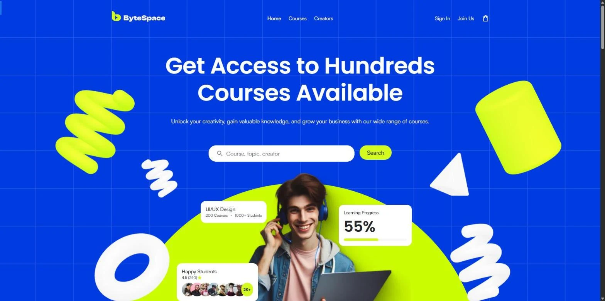
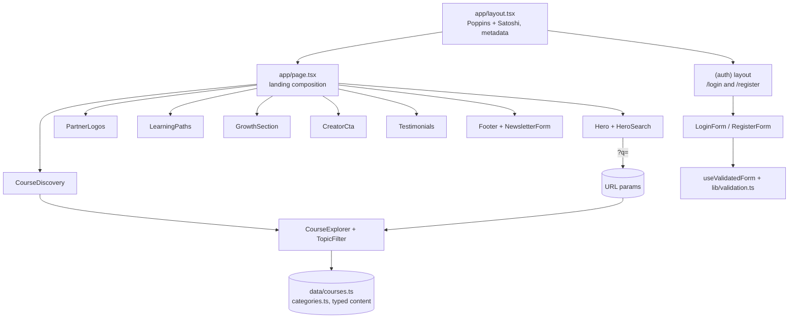

<div align="center">



<p><code>A Figma-to-code recreation of the ByteSpace course platform landing page, built with Next.js 16 and Tailwind CSS v4</code></p>

<p>
<a href="https://bytespace-learn.vercel.app"></a>
<a href="https://github.com/Saji-d/bytespace-learn"></a>

</p>

<p>


</p>

> Built as a technical assessment. Independent implementation, not affiliated with or endorsed by any company.

<p>
<a href="#-overview">Overview</a> · <a href="#-highlights">Highlights</a> · <a href="#-preview">Preview</a> · <a href="#-architecture">Architecture</a> · <a href="#-tech-stack">Tech Stack</a> · <a href="#-getting-started">Getting Started</a> · <a href="#-project-structure">Structure</a> · <a href="#-assessment">Assessment</a> · <a href="#-author">Author</a>
</p>

</div>


## ◈ Overview

ByteSpace is a course-platform landing page rebuilt from a 1440px Figma design. It was my final project for a Junior Software Engineer (Frontend) technical assessment.

The page covers the hero with course search, partner logos, course discovery with topic filtering, learning-path categories, a two-part growth section, a creator call to action, testimonials and a footer. I also added login and register pages as a bonus, plus a branded 404.

> **Honest scope.** This is a frontend-only assessment project. There is no backend, database or real authentication. Course data is a typed file in `src/data/`; the newsletter, login and register forms validate input and simulate submission in the browser.


## ◈ Highlights

<table width="100%">
<tr>
<td width="33%" valign="top">

**Design tokens from Figma**<br/>
The Electric Violet blue (`#003BE2`) and lime (`#D4FB20`) palette lives as Tailwind v4 theme tokens in `globals.css`.

</td>
<td width="33%" valign="top">

**Shareable search and filters**<br/>
Course search and topic chips are driven by URL params (`q` and `topic`), so a filtered view is a link.

</td>
<td width="33%" valign="top">

**Responsive layouts**<br/>
The 1440px frame scales down through 1024, 768 and 640px breakpoints, with a keyboard-accessible mobile navigation.

</td>
</tr>
<tr>
<td width="33%" valign="top">

**Signature grid backdrop**<br/>
The faint 120px line grid from the design is a CSS gradient aligned to the page centre at any width.

</td>
<td width="33%" valign="top">

**Scaled stages**<br/>
Photo collages and floating cards are positioned from the design's own coordinates and scale proportionally.

</td>
<td width="33%" valign="top">

**Bonus auth pages**<br/>
Login and register with a reusable validation hook, inline errors and a course-aware enrolment note.

</td>
</tr>
<tr>
<td width="33%" valign="top">

**Mostly static**<br/>
Pages are prerendered with the App Router. Only search, filters, forms and the mobile menu ship client JavaScript.

</td>
<td width="33%" valign="top">

**Typed component library**<br/>
Reusable `Container`, `Button`, `TextField`, `Decor` and `AvatarStack` building blocks.

</td>
<td width="33%" valign="top">

**Accessible details**<br/>
Semantic landmarks, labelled controls, `aria-pressed` filters, visible focus styles and reduced-motion support.

</td>
</tr>
</table>


## ◈ Preview

<div align="center">

</div>

Open the [live demo](https://bytespace-learn.vercel.app) to see the full page, the filters and the `/login` and `/register` pages.


## ◈ Architecture

The landing page is a server-rendered composition of sections. A small set of client components handles interaction. The course list reads URL params inside a `Suspense` boundary to keep the page static.




## ◈ Tech Stack

| Layer | Technologies | Purpose |
|---|---|---|
| Framework | Next.js 16 (App Router, Turbopack), React 19 | Routing, server rendering and static output |
| Language | TypeScript (strict) | Typed components and content |
| Styling | Tailwind CSS v4 | Design tokens and responsive utilities |
| Fonts | Poppins via `next/font`, self-hosted Satoshi | Headings and body text |
| Images | `next/image`, WebP and SVG exports from Figma | Responsive, optimised assets |
| Tooling | ESLint (`next/core-web-vitals`) | Linting |
| Hosting | Vercel | Public deployment |

No UI kit and no runtime dependencies beyond Next.js and React.


## ◈ Getting Started

Requires Node.js 18 or newer. No environment variables are needed.

```bash
git clone https://github.com/Saji-d/bytespace-learn.git
cd bytespace-learn
npm install
npm run dev      # http://localhost:3000
```

```bash
npm run build    # production build
npm run start    # serve the production build
npm run lint     # ESLint
```


## ◈ Project Structure

Pages and components live in `src/app` and `src/components`, typed content in `src/data`, helpers in `src/lib` and Figma exports in `public/images`.

<details>
<summary>Open the folder map</summary>

```text
src/
├── app/                  # routes, root layout and global design tokens
│   ├── (auth)/           # shared shell for /login and /register
│   ├── globals.css       # Tailwind v4 theme tokens
│   ├── layout.tsx        # fonts and metadata
│   ├── page.tsx          # landing page composition
│   └── not-found.tsx     # branded 404
├── components/
│   ├── layout/           # Header, MobileNav, Footer, NewsletterForm
│   ├── sections/         # Hero, PartnerLogos, CourseDiscovery, LearningPaths, ...
│   ├── course/           # CourseCard, CourseGrid, TopicFilter, CourseExplorer
│   ├── growth/           # collage compositions, ScaledStage, GlowField
│   ├── cards/            # floating stat cards
│   ├── auth/             # auth card, intro, forms, social sign-in UI
│   ├── forms/            # TextField and validation hook
│   ├── ui/               # Container, Button, Logo, Decor, AvatarStack, GridBackdrop
│   └── icons.tsx         # inline SVG icon set
├── data/                 # typed content: courses, categories, testimonials, navigation
├── fonts/                # self-hosted Satoshi with its licence
└── lib/                  # cn() helper and validation helpers
public/images/            # optimised Figma exports
```

</details>


## ◈ Assessment

<details>
<summary><strong>Assessment checklist</strong></summary>

| Requirement | Status |
|---|---|
| Complete landing page from the provided Figma design | Done |
| Public GitHub repository | Done |
| Separate feature branch and pull request | Done (`feature/bytespace-assessment`) |
| Vercel deployment with a public URL | Done |
| Bonus: login and signup pages | Done |

</details>

> Design, imagery and 3D ornaments come from the Figma file provided with the assessment. Fonts: [Satoshi](https://www.fontshare.com/fonts/satoshi) by Fontshare (licence in `src/fonts`) and [Poppins](https://fonts.google.com/specimen/Poppins) by Google Fonts.


## ◈ Author

**Sajidur Rahman Sajid**: Full-Stack Developer and AI engineer from Dhaka.<br>
BSc in CSE at American International University-Bangladesh (AIUB).

<p>
  <a href="https://www.sajidur.me"></a>
  <a href="https://www.linkedin.com/in/sajidur-rahman-sajid/"></a>
  <a href="https://github.com/Saji-d"></a>
  <a href="mailto:sajidsajidurrahman99@gmail.com"></a>
</p>

<sub>Built as a frontend assessment and portfolio piece.</sub>
